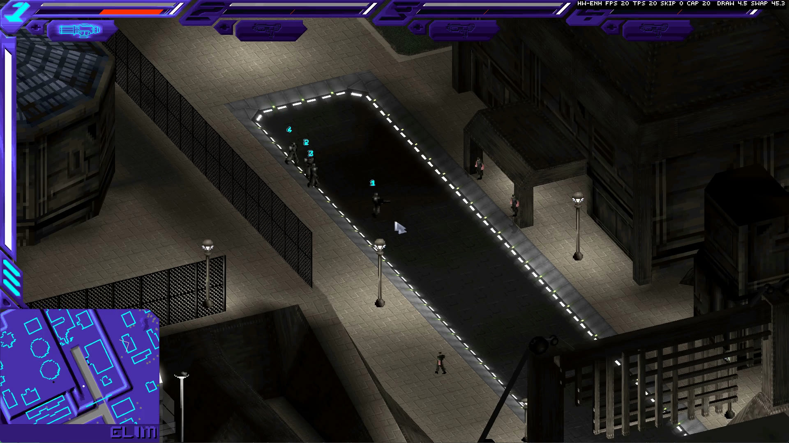

# SyndWarsFX - Syndicate Wars Fan Expansion (fork with GPU rendering and quality-of-life work)



**Video:** [Watch the fork in action on YouTube](https://www.youtube.com/watch?v=IL2CsT9U9sA)

**Syndicate Wars Fan Expansion** is an Open Source remake of the classic 1996
Bullfrog game *Syndicate Wars*. This repository is a fork of the SyndWarsFX
project, adding an OpenGL presentation path, optional hardware (GPU) rendering of
the 3D scene with improved lighting, a faster software renderer, new camera and
selection controls, and a working modern Windows build setup.

* Fork (this repository): <https://github.com/Replica-/swars>
* Upstream SyndWarsFX: <https://github.com/swfans/syndwarsfx>
  ([discussions](https://github.com/swfans/syndwarsfx/discussions),
  [wiki](https://github.com/swfans/syndwarsfx/wiki),
  [Discord](https://discord.gg/cnHmWqe49t),
  [Google group](http://groups.google.com/group/syndicate-wars-port))

## Credits

This project stands on the work of others, and keeps their credit:

* **Bullfrog Productions** - the original *Syndicate Wars* (1996). All game
  assets and the original design and code belong to them (and the current rights holders).
* **Unavowed** and **Gynvael Coldwind** - the original port, created by
  disassembling the DOS executable and replacing the DOS specific parts with
  platform independent code.
* **The SyndWarsFX contributors** (<https://github.com/swfans/syndwarsfx>,
  notably **Tomasz Lis**, whose name is on most of the source headers) - who
  continued the port, remade most of the original assembly in C, and expanded
  the game: higher resolutions, new data packages, revived cut features, fixes.
* Everyone who signed their commits in the upstream repository.

The code is distributed under the GNU General Public License (see `COPYING`
and `GPL3`). The changes described in this document were made on top of upstream,
and are covered by the same license.

## What this fork adds

### Graphics

* **OpenGL presentation.** The window now has a GL 3.3 context. The 8-bit game
  screen is uploaded as a texture, and the palette is expanded on the GPU, so the
  CPU no longer converts every frame to 32 bits and scales it. If the context
  cannot be created, the game falls back to the plain SDL window as before
  (`SWFX_NO_GL=1` forces that). The FPS counter shows `GL` or `SW`.
* **Hardware (GPU) rendering of the 3D world, on by default.** While the scene is
  drawn, the triangles which the software renderer would rasterize are recorded
  instead, and drawn by the GPU when the frame is shown, in the same order, using the
  same texture pages, palette and colour tables. The HUD and menus are still
  drawn by the software renderer, and put on top. Sprites (people, vehicle lights,
  smoke, effects) and lines (such as lamp post poles) are drawn by the GPU as well, in
  the same order as the polygons, so what is in front of them hides them correctly. The draw time in a mission dropped
  from about 15 ms to about 4-5 ms. `Shift+F3` switches between hardware and
  software rendering at any time; `SWFX_HW=0` starts with software rendering.
* **Improved ("enhanced") lighting in the hardware renderer.** Shade is
  interpolated smoothly between the rows of the game's fade table instead of
  jumping from row to row, which removes the banding in light pools; shadows darken
  by the correct amount; very bright colours roll off softly. The brightness is
  calibrated to the software rendering. `Shift+F4` switches to the classic
  lighting, which repeats the palette shading of the software renderer.
* **Neon and bloom.** In the enhanced lighting, bright and saturated colours
  (neon strips, signs, lights on the street tiles) are not darkened by the shade of
  their place and are slightly stronger than the palette has them, and the near-white
  parts of the scene glow, with a blurred bloom pass in a floating point buffer. Only
  the map and the buildings glow - sprites such as smoke, people and effects do not.
* **Smooth camera.** The game turns still run at the frame rate cap, but while the
  view is panned, zoomed or rotated, extra frames are drawn between the turns, with
  the camera moved between its previous and its current position, so the view
  moves at about 60 frames per second (the counter shows `FPS` 60 and `TPS` 20).
  Nothing else moves between the turns, and the frame of the turn is shown last, so it
  adds no delay. `SWFX_SMOOTH_CAMERA=0` turns it off.
* **Faster map scrolling.** Panning with the keys or the screen edge is 1.5 times
  faster than in the original game.
* **Faster software renderer.** The textured polygon fill (`poly_gp.c`) is
  rewritten to keep its state in registers and is compiled optimized; a busy mission
  scene went from about 40 ms to about 15 ms per frame in a debug build.
* **Hardware mouse cursor.** The pointer is drawn by the OS from the game's pointer
  sprite instead of being painted into the game image, so it moves smoothly at the
  full rate of the display, whatever the game's frame rate (`SWFX_SOFT_CURSOR=1`
  brings back the game-drawn one).
* **No sphere distortion.** Missions start in the flat isometric view; the
  perspective projection (which bends the map at the screen edges and spoils the
  mouse picking there) is still available with the `F` key.
* **Much wider zoom.** The zoom range is 16 to 600 (`ZoomMin` and `ZoomMax` in
  `conf/rules.ini`), and the minimum zoom no longer depends on the weapon range.

### Controls

| Action | Key |
|---|---|
| Rotate the view left / right | `Q` / `E` |
| Pan the view | `W` `A` `S` `D` (arrow keys also pan) |
| Zoom | mouse wheel, `Home` (out) / `End` (in) |
| Select several agents | hold `Shift` and drag a box with the left mouse button |
| Centre the view on an agent | double-tap the agent's number key (`1`-`4`) |
| Scanner pulse | `X` |
| Self destruct | `Alt`+`V` |
| Frame skip (fast forward) | numpad `+` / `-` |
| Frame rate cap | `[` lower, `]` raise (above the highest value the cap is removed) |
| Hardware / software rendering | `Shift`+`F3` |
| Classic / enhanced lighting | `Shift`+`F4` |
| Sampling profiler | `Ctrl`+`F7` (also `Scroll Lock`, `Pause`); press to start and again to stop; writes `profile_samples.txt` |

* **Drag selection.** The box selects the agents which it overlaps, and only them:
  the first covered agent (the current one, if it is covered) becomes the
  controlled agent, the other covered agents are made to follow and protect it,
  and agents outside of the box are released from any such group. A click with
  `Shift` selects the agent under the cursor. (In network games only the selection
  is done.)
* **Frame rate.** The game logic runs once per drawn frame, so the cap sets the
  game speed too; 16 is the original pace, and this fork starts with 20. Frame skip draws every Nth turn and does
  not wait at all. Both are shown, with the measured frame rate, turn rate and the
  time spent drawing and presenting, in the counter at the top right of a mission.
* Key bindings are the defaults; keys saved by the game's key setup override them.

### Interface and speed

* The animations of the menus and mission screens (boxes drawing in from the
  centre, text appearing) run 3x and 2x faster.
* The frame rate cap, frame skip and the mouse wheel were added (above); the frame
  skip keys no longer need `Ctrl`, and frame skip now really skips drawing.
* The in-mission FPS counter and the sampling profiler (above) help finding
  what is slow.

### Command line and environment

New command line options:

| Option | Meaning |
|---|---|
| `-b`, `--background` | open the window in the background, without taking the focus |
| `-M`, `--mute` | mute all sound |

Existing options which are useful for testing: `-m <campaign>,<mission>` starts a
mission directly, `-q` skips the intro, `-W` runs in a window.

Environment variables:

| Variable | Meaning |
|---|---|
| `SWFX_NO_GL` | do not use OpenGL at all (use the plain SDL window) |
| `SWFX_HW=0` / `software` | start with the software renderer for the 3D scene |
| `SWFX_HW=classic` | hardware rendering with the classic lighting |
| `SWFX_SMOOTH_CAMERA=0` | turn off the smooth camera (extra frames between game turns while panning, zooming and rotating) |
| `SWFX_SOFT_CURSOR` | draw the mouse pointer in the game image instead of the OS |
| `SWFX_NO_EDGE_SCROLL` | do not scroll the view when the mouse is at the screen edge (for tests) |

### Build, tools and fixes

* A working Windows (MSYS2, 32-bit) build, with the pitfalls found on the way
  documented below. Notably, the build must use SDL2: without it, `configure`
  quietly selects SDL 1.2, which leaves a black intro video and a black menu
  background.
* VS Code `launch.json` / `tasks.json` with grouped configurations: debug, debug
  straight into a mission, release; each with a build-and-launch variant. The
  debug and build-and-launch entries start the game in the background and muted.
* A release build which is safe for the game's assembly code (see below), with
  only the rendering library optimized.
* The debug build no longer enables verbose logging by default; with it, every drawn
  sprite opened and closed the log file, which made busy scenes very slow.

---

## About the port

The port was created by disassembling the original DOS executable and replacing
the DOS-specific parts with platform-independent code, using
[SDL](https://www.libsdl.org/) for input and video display,
[Vorbis](https://xiph.org/vorbis/) for music and [OpenAL](https://www.openal.org/)
for sound. It runs on Windows, GNU/Linux and Mac OS, on the i386 architecture.

Nothing is missing from the single player gameplay, since the port uses the original
code for parts which are not remade yet. Multiplayer is not working - network code
is missing; it will allow starting a new MP game with one player and no real network
connection.

You need the original game data (from the *Syndicate Wars CD* or a digital
distribution of the game) to play; see [Installation](#installation).

---

## Installation

To install **SyndWarsFX**, you need the original *Syndicate Wars CD* or a *SW CD
image* from a digital distribution. The multi-lingual european release and the
american release were tested; other versions were not fully tested. Only PC releases
can be used. Languages: the multi-lingual CD has `eng` `fre` `ita` `spa` `swe`, the
German release is needed for `ger`, the Japanese "SW Premium" has `eng` `fre` `jap`
(asian fonts are not supported). The language can be changed in `config.ini`.

The easiest way is to use the installer from the upstream project's releases
(Windows), or the `util/install` script (GNU/UNIX, and with MSYS2/Cygwin/WSL on
Windows):

```
util/install -f <SOURCE> -t <TARGET> -l <LANG>
```

where *SOURCE* is the mounted game CD, *TARGET* the installation folder and *LANG*
one of `eng` `fre` `ger` `ita` `spa` `swe`. The script copies the files from the
CD and downloads the additional data packages
([gfx](https://github.com/swfans/syndwarsfx-gfx/releases),
[sfx](https://github.com/swfans/syndwarsfx-sfx/releases),
[levels](https://github.com/swfans/syndwarsfx-levels/releases)). Then put the built
executable, the DLLs and the `conf` folder of this repository next to the data
(`conf`, `data`, `levels`, `intro`, `language`, ... and the executable have to be in
one folder).

Music: rip the CD tracks to `track_{1,2,3}.ogg` into a `music` folder
(optional).

### Starting the game

```
./syndwarsfx -g          (GNU/Linux, Mac OS)
syndwarsfx.exe /g        (Windows)
```

`--help` lists all the options. If something does not work, check the `error.log`
file written while the game starts, and the upstream
[wiki](https://github.com/swfans/syndwarsfx/wiki).

---

## Building

The port can only be built for the x86 architecture: you need a 32-bit OS, or a
64-bit OS with 32-bit toolchain and libraries.

### Requirements

* GNU Autotools (autoconf, automake), GNU C/C++ compiler, GNU make, pkg-config
* Python 3 with the `polib` module (builds the language files)
* `vorbis-tools` (oggenc) and `cdparanoia` (for the installer scripts)
* Development libraries: **SDL2** (SDL 1.2 works, but see the warning below),
  OpenAL (OpenAL Soft is recommended), libvorbis, libogg, libpng, zlib,
  WildMIDI
* For the hardware rendering: a GPU and driver with OpenGL 3.3. Nothing has to be
  linked for it - the GL functions are loaded at run time, and without them the game
  runs with the software renderer.

### Build flags (all platforms)

* `--disable-lb-wscreen-control` is required. The assembly code needs the
  application to own the screen buffer.
* `-m32 -fno-PIC -fno-PIE` are required for the compiler and linker flags. Position
  independent code is not compatible with the assembly code of the project.
* **Do not build everything with `-O2`.** The hand-written assembly and the remade C
  code call each other with register conventions that the optimizer does not know
  about, and an optimized build crashes in the assembly. Optimizing only
  self-contained C code is safe; this is what the project does: `poly_gp.c` carries
  a `#pragma GCC optimize ("O2")`, and the rendering library (`swrendersoft`) is built
  with `-O2` for the release build (see below).
* For a debug build add `-g -O0 -Wall`. Add `-DDEBUG -D__DEBUG` only when you want
  the very verbose logging; it makes the game slow.

### Windows (MSYS2, MINGW32 shell)

Install [MSYS2](https://www.msys2.org/) and, in the **MSYS2 MINGW32** shell, the
32-bit toolchain and libraries:

```
pacman -S mingw-w64-i686-binutils mingw-w64-i686-autotools mingw-w64-i686-pkgconf \
          mingw-w64-i686-make mingw-w64-i686-gcc mingw-w64-i686-libpng \
          mingw-w64-i686-SDL2 mingw-w64-i686-openal mingw-w64-i686-libvorbis \
          mingw-w64-i686-libogg
```

WildMIDI is not packaged for MSYS2, install it by hand:

```
pacman -S unzip
wget https://github.com/Mindwerks/wildmidi/releases/download/wildmidi-0.5.0/wildmidi-0.5.0-windows.zip
unzip wildmidi-0.5.0-windows.zip
cp wildmidi-0.5.0-windows/include/*.h /mingw32/include/
cp wildmidi-0.5.0-windows/x86/*.a /mingw32/lib/
cp wildmidi-0.5.0-windows/x86/*.dll /mingw32/bin/
pip install polib
```

Make sure `polib` is installed for the Python which the build uses (MSYS2 has
separate `i686` and `x86_64` Pythons). Then generate the build scripts, once:

```
PATH="/mingw32/bin:$PATH" autoreconf -ivf --include=/mingw32/share/aclocal/
```

**Debug build**, in a separate folder:

```
mkdir -p debug && cd debug
PATH="/mingw32/bin:$PATH" PKG_CONFIG_PATH="/mingw32/lib/pkgconfig:/mingw32/share/pkgconfig" \
  CFLAGS="-m32 -fno-PIC -fno-PIE -g -O0 -Wall" CXXFLAGS="-m32 -fno-PIC -fno-PIE -g -O0 -Wall" \
  LDFLAGS="-m32 -fno-PIC -fno-PIE" ../configure --disable-lb-wscreen-control
make -j$(nproc)
```

**Release build** (no `-g`, with the rendering library optimized):

```
mkdir -p release && cd release
PATH="/mingw32/bin:$PATH" PKG_CONFIG_PATH="/mingw32/lib/pkgconfig:/mingw32/share/pkgconfig" \
  CFLAGS="-m32 -fno-PIC -fno-PIE" CXXFLAGS="-m32 -fno-PIC -fno-PIE" \
  LDFLAGS="-m32 -fno-PIC -fno-PIE" ../configure --disable-lb-wscreen-control
sed -i 's/^CFLAGS = -m32 -fno-PIC -fno-PIE /CFLAGS = -m32 -fno-PIC -fno-PIE -O2 /' swrendersoft/Makefile
make -j$(nproc)
```

(The `sed` edits the generated Makefile of the rendering library, and has to be
repeated after running `configure` again.)

The executable is `<build folder>/src/syndwarsfx.exe`. To run it, put the game
data, the `conf` folder (copy the files from the repository's `conf/`), the SDL2 /
OpenAL / vorbis / png / zlib / WildMIDI DLLs and `config.ini` into the `src` folder
of the build, or install it (`make prefix=<TARGET> install`) next to the data.

**Pitfalls**

* **SDL2 is required for a working game.** If `configure` prints
  `checking for sdl2 >= 2.0.0... no` it uses SDL 1.2 instead, and the result has a
  black intro movie and menu background. Install `mingw-w64-i686-SDL2` and run
  `configure` again.
* **Old DLLs break the build.** The compiler loads DLLs from the current folder
  first. If the build folder's `src` has older copies of `libgcc_s_dw2-1.dll`,
  `libstdc++-6.dll` or `zlib1.dll` than the toolchain, every compile fails
  silently with exit code 1. Move the DLLs out while building and put them back
  afterwards.
* The first parallel `make` may fail with a race on a generated header or on the
  `wrappers_*.sx` files; run `make` again (delete truncated `wrappers_*.sx` if
  there are `undefined reference to ac_...` errors).
* After pulling changes to `Makefile.am` or `configure.ac`, run the
  `autoreconf` command above again.
* The `conf/*.ini` files must come from the same version as the executable;
  a stale `conf` folder produces `Could not read "LevelNo"` warnings in `error.log`
  and wrong missions.

### GNU/Linux

On Ubuntu 20.04 64-bit, as an example:

```
sudo dpkg --add-architecture i386
sudo apt install gcc-multilib g++-multilib lib32z1 autoconf python3 python3-polib \
     vorbis-tools cdparanoia libsdl2-dev:i386 libpng-dev:i386 libopenal-dev:i386 \
     libvorbis-dev:i386 libvorbisfile3:i386 libogg-dev:i386 libwildmidi-dev:i386
autoreconf -ivf
mkdir -p release && cd release
PKG_CONFIG_PATH="/usr/lib/i386-linux-gnu/pkgconfig" CFLAGS="-m32 -fno-PIC -fno-PIE" \
  CXXFLAGS="-m32 -fno-PIC -fno-PIE" LDFLAGS="-m32 -fno-PIC -fno-PIE" \
  ../configure --disable-lb-wscreen-control
make V=1
```

For a debug build use `-g -O0 -Wall` instead, as above. `make V=1 check` runs the
build self tests. Install with `make prefix=<TARGET> install`.

### Mac OS X

Mac OS X is a UNIX system; follow the GNU/Linux steps with `CFLAGS="-arch i386"`,
`./configure --disable-lb-wscreen-control CFLAGS="-arch i386"`. For an application
bundle, see `util/mkbundle` and the upstream documentation.

### Visual Studio Code

`.vscode/launch.json` and `.vscode/tasks.json` assume the MSYS2 installation in
`D:/development/msys64` and the `debug` and `release` build folders in the repository
root; adjust the paths for your machine. The launch dropdown is grouped:

* **Debug** - launch, build and launch, build only (the first two start the game in
  the background and muted: `-b -M`)
* **Mission** - the same, straight into mission 1 (`-m 0,1 -q -W`)
* **Release** - launch, build and launch, build only

---

## How the hardware rendering works

For people who want to work on it:

* `bflibrary/src/x86-win-sdl2/sgl.c` - GL context creation (3.3 core, loaded at run
  time through `SDL_GL_GetProcAddress`), and presenting the 8-bit screen with a palette
  lookup shader. `privgl.h` holds the table of GL functions.
* `bflibrary/src/general/ghwrend.c` - the recorder. `draw_trigpoly()` hands every
  triangle to it while the scene is being drawn (between `draw_explode()` and the end
  of `draw_screen()`, see `lvdraw3d.c`); triangles whose texture is not one of the
  texture pages are left to the software renderer.
* `bflibrary/src/x86-win-sdl2/sglrend.c` - draws the recorded vertices with one
  shader, which reproduces the render modes of the software renderer (flat, textured,
  shaded through the fade table, colour keyed, shadows, and the transparent modes
  approximated with alpha blending). The software screen of the frame is then
  put on top; palette index 255 means "not drawn here".
* Painter's order is preserved, there is no depth buffer.

Sprites and lines are recorded in the same stream (`LbHwRecordSprite`,
`LbHwRecordLine`; sprites are packed in an atlas on first use). The bloom is made in
`LbGlSceneDrawWithBloom`: the scene goes to two floating point targets (the colour,
and the part which is allowed to glow), the bright part is reduced, blurred and added
back when the scene is put in the window.

Known limitations: dynamic per-pixel lights are not done yet; the transparency of
screen-blending modes is approximate; the HUD and menus are still drawn by the
software renderer.

---

## Community

For discussion or problems, see the upstream
[discussions page](https://github.com/swfans/syndwarsfx/discussions), the
[Syndicate Discord channel](https://discord.gg/cnHmWqe49t), or the Google group
[syndicate-wars-port](http://groups.google.com/group/syndicate-wars-port). Issues
specific to this fork belong in <https://github.com/Replica-/swars/issues>.

That's all. Have a nice play!
